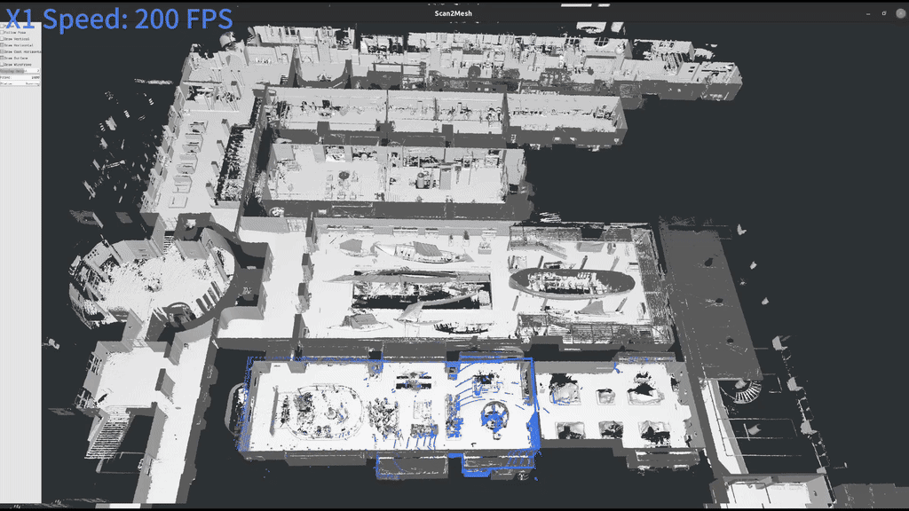
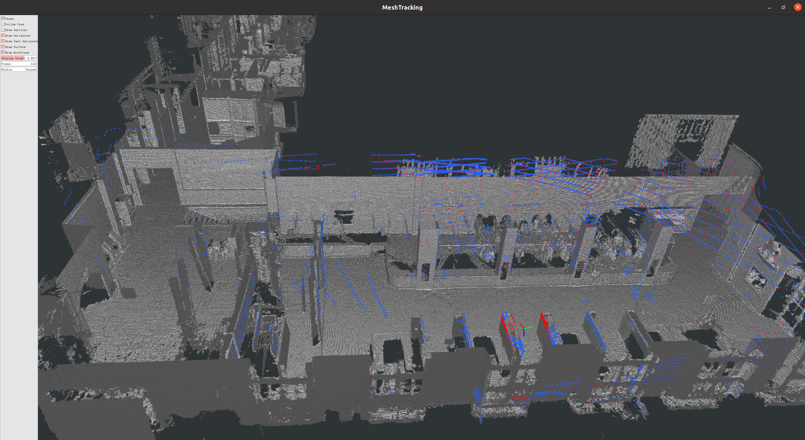
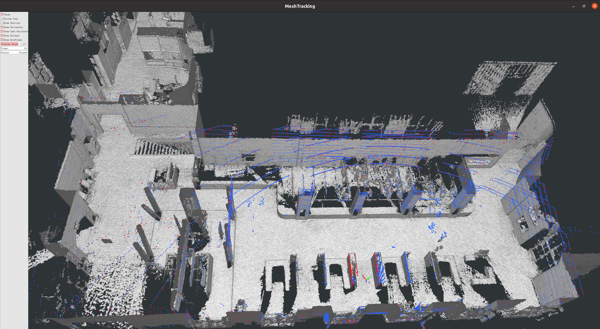
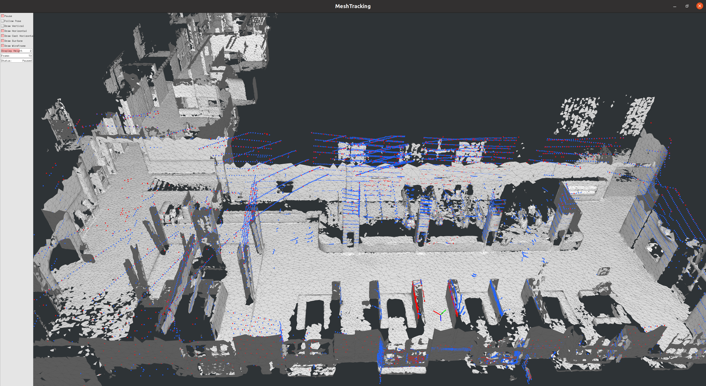
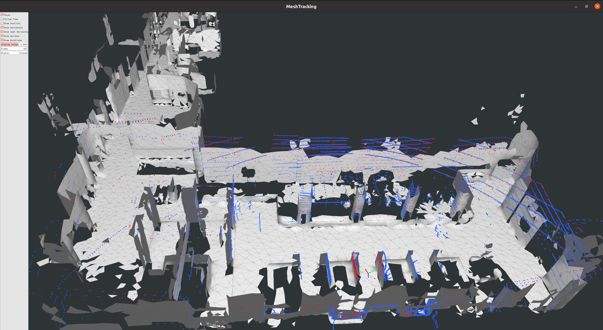

# Scan2Mesh: Lightweight Mesh Maps for High-Speed LiDAR Registration

Scan2Mesh is a high-performance mesh-based LiDAR localization and tracking system that estimates LiDAR poses by aligning incoming scans with a pre-built 3D mesh. It achieves real-time tracking rates of **up to 200 Hz using only a single CPU core**, tested on an Intel Core i9-10900K and NVIDIA GeForce RTX 3080 Ti.

The system uses Embree for CPU-based mesh raycasting and CUDA for accelerated ICP computation and reduction. Raycasting is currently the primary performance bottleneck. Replacing the CPU-based Embree pipeline with GPU-accelerated raycasting using CUDA, OptiX, or Vulkan Ray Tracing could significantly increase overall tracking performance.

## Demo Video on YouTube

[](https://www.youtube.com/watch?v=8QdXkUA7Etw)

*Scan2Mesh: Lightweight Mesh Maps for High-Speed LiDAR Registration*


## Compact Mesh Representation

Scan2Mesh remains reliable with highly simplified meshes as long as the main geometric structure of the environment is preserved.

A **3,000 m² scene can be represented by a mesh of approximately 0.6 MB** while maintaining reliable tracking.

This compact map representation enables:

* **Low storage and memory requirements**
* **Fast deployment and network distribution**
* **Scalable management of large numbers of environments**
* **Deployment on embedded and edge devices**

These advantages make Scan2Mesh well suited for large-scale deployment and cloud or edge-based localization systems.



## Requirements

The default build runs ICP on the CPU and has no CUDA or PCL dependency.

| Dependency | Purpose |
| ---------- | ------- |
| C++17 compiler and CMake 3.18+ | Build system |
| Eigen | Pose math and linear solving |
| Embree 4 | CPU mesh raycasting |
| Boost.Thread | Shared tracking/viewer state |
| URDFDOM | Sensor extrinsic calibration |
| Pangolin (optional) | Tracking viewer |
| CUDA toolkit (optional) | CUDA ICP backend |

PLY input/output uses the bundled tinyply files in `utils/`. Meshes must have
triangular faces. ASCII, binary little-endian and binary big-endian files are
supported, including reordered properties, float/double coordinates and optional
RGB colors. Invalid indices, non-triangular faces, truncated data and non-finite
coordinates are rejected. Cloud colors default to black when absent; tracking
uses the green channel to distinguish the two LiDARs, so tracking input must
preserve those sensor labels (`green == 0`: vertical; otherwise: horizontal).

## Build

```bash
cmake -S . -B build -DSCAN2MESH_TRACKING_BACKEND=CPU
cmake --build build --parallel
ctest --test-dir build --output-on-failure
```

On macOS, the CPU build dependencies can be installed with Homebrew:

```bash
brew install cmake eigen embree boost urdfdom
```

To enable the Pangolin viewer, install Pangolin and configure with
`-DSCAN2MESH_BUILD_VISUALIZATION=ON`. The default is headless; passing `-vs`
to a build without the viewer produces an explicit error.

To select CUDA ICP on a machine with a CUDA toolkit and NVIDIA GPU:

```bash
cmake -S . -B build-cuda -DSCAN2MESH_TRACKING_BACKEND=CUDA \
  -DCMAKE_CUDA_ARCHITECTURES="75;86"
cmake --build build-cuda --parallel
ctest --test-dir build-cuda --output-on-failure
```

Set `CMAKE_CUDA_ARCHITECTURES` for the deployment GPU(s). CUDA files are compiled
once and only for the CUDA backend. Both backends use Embree raycasting,
point-to-plane residuals, Huber weights, the same pose update convention and
checks for insufficient correspondences, degenerate geometry and non-finite solves.
A failed ICP estimate leaves the previous pose intact and logs the failed timestamp.
The CPU build and synthetic tests have been verified on Apple Silicon; CUDA and
the optional Pangolin viewer require validation on a suitably equipped system.

## Running Mesh Tracking

The reconstructed mesh generated by **Eternelle3D**, together with the LiDAR input data used for tracking, is available from the following links:

* **Baidu Netdisk:** [Download](https://pan.baidu.com/s/1A-6-BX3Ymh_QDA7vpRA-Aw?pwd=337q) **Extraction code:** `337q`
* **Google Drive:** [Download](https://drive.google.com/drive/folders/1vpH2tYxNEiRKxMx__5SjivoDiwhDMmJY?usp=drive_link)

This example uses data from the [Cartographer Deutsches Museum dataset](https://google-cartographer-ros.readthedocs.io/en/latest/data.html#d-cartographer-backpack-deutsches-museum-1). The reference mesh was reconstructed at a **2.5 cm spatial resolution** using the **Eternelle3D** reconstruction algorithm.

### Run Mesh Tracking

After compiling the project, run the `mesh_tracking` executable from the build directory:

```bash
./mesh_tracking -m <mesh_file> -d <data_directory> -u <urdf_file>
```

For example:

```bash
./mesh_tracking \
  -m ${HOME}/node_data/b3-2016-03-01-13-39-41_mesh_0.1.ply \
  -d ${HOME}/node_data/ \
  -u ${HOME}/scan2mesh/backpack_3d.urdf
```

## Command Line Arguments

| Option | Description                                                                                      |
| ------ | ------------------------------------------------------------------------------------------------ |
| `-m`   | Path to the reference mesh used for LiDAR tracking and raycasting.                               |
| `-d`   | Path to the input data directory containing LiDAR and sensor data.                               |
| `-u`   | Path to the URDF sensor configuration file defining sensor poses and coordinate transformations. |
| `-vs` | Enable visualization (requires a build with the viewer enabled). |
| `-gpu` | CUDA device index, selected before device allocations. |
| `-cloud-frame` | `imu` (default) or `sensor`; coordinate frame of input points. |

Input data must contain `trajectory.poses` with rows
`timestamp_us x y z qx qy qz qw`, and scans in
`ply_folder/<timestamp_us>.ply`. Timestamps are sorted and deduplicated; invalid
poses are skipped and valid quaternions are normalized. The first valid pose
initializes tracking. Subsequent reference poses provide diagnostics only and
do not overwrite the estimated trajectory.

The default `-cloud-frame imu` preserves the combined-cloud input convention:
each labeled scan is converted once from IMU to its sensor frame. With
`-cloud-frame sensor`, each labeled point is already in its corresponding LiDAR
frame. ICP and raycasting consume sensor-frame points, while the viewer applies
the current sensor-to-world pose to those same points.

The raycasting utility shares the tracker’s raycaster and writes to a configurable
path instead of a hard-coded home directory:

```bash
./mesh_raycast mesh.ply cloud.ply [output.ply]
```

Its input cloud is in the mesh coordinate frame with the sensor at the origin.
The default output is `casted_points.ply` in the current directory.

## Mesh Simplification

The 2.5CM resolution mesh created by Eternelle3D can be significantly simplified using **Quadric Error Metrics (QEM) mesh decimation** while preserving the overall geometric structure required for LiDAR tracking.

QEM-based decimation reduces the number of triangles by iteratively collapsing edges while minimizing the geometric error introduced to the mesh. This allows the mesh size to be dramatically reduced while retaining the major surfaces and structural features of the environment.

<table>
<tr>
<td align="center">

2.5cm Resolution Mesh Created by Eternelle3D
</td>

<td align="center">

QEM Decimation × 0.1
</td>
</tr>

<tr>
<td align="center">

QEM Decimation × 0.01
</td>

<td align="center">

QEM Decimation × 0.001
</td>
</tr>
</table>

## FAQ

**Q: How should I tune the tracking parameters?**

The tracking parameters can be adjusted according to the quality of the initial pose and the desired tracking performance.

* **`dist_thresh`** (default: `2.0 m`): If a reliable initial pose is available from an IMU or another localization source, this value can be reduced accordingly. A smaller threshold reduces the search range and can improve tracking efficiency and robustness.
* **Adaptive Voxel Point Number** (default: `2000`): Controls the number of points retained after voxel downsampling. This value can be tuned based on the desired balance between tracking accuracy, robustness, and computational performance. Increasing the point count may improve tracking quality, while reducing it can increase processing speed.

**Q: Does mesh size affect tracking performance?**

Yes. Larger and more complex meshes generally increase raycasting time, which can reduce the overall tracking rate. However, Scan2Mesh can still handle large-scale environments efficiently. In our tests, a **200 MB mesh covering approximately 50,000 m²** can achieve real-time tracking rates of **up to 150 Hz**.

**Q: What QEM decimation ratio should I use for the mesh?**

The initial mesh is generated at **2.5 cm resolution** using Eternelle3D. In practice, a **50×–100× QEM decimation ratio** can significantly reduce the mesh size while retaining sufficient geometric details for reliable tracking.

**Q: Why are the raycasted points not exactly the same as the input LiDAR points?**

1. **LiDAR motion distortion** — points are measured at different times while the sensor is moving, but raycasting assumes a single fixed LiDAR pose.
2. **Sensor calibration & measurement errors** — small LiDAR–mesh extrinsic errors, angular calibration errors, and measurement noise can cause slight offsets.
3. **Mesh approximation** — raycasting hits the reconstructed/decimated mesh, which may not exactly represent the real measured surface.

## License

Scan2Mesh is source-available under the Eternelle Non-Commercial License.

The source code may be used, modified, and distributed for non-commercial
purposes, including research, education, and evaluation.

Commercial use requires a separate commercial license from the Eternelle Authors. For commercial licensing, please contact us.